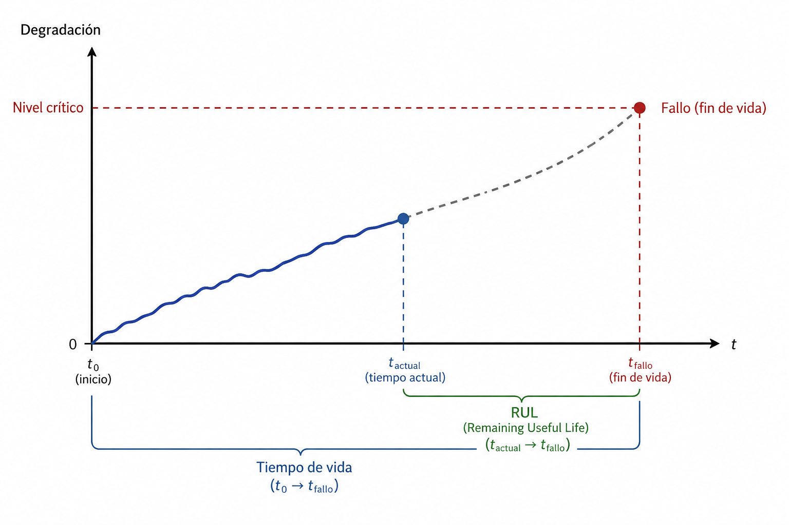

# Introducción a la degradación

Existen varios tipos de estudio en confiabilidad. Pruebas tradicionales: se registran únicamente tiempos de falla de las unidades; pruebas de vida acelerada: las unidades se someten a niveles altos de esfuerzo; pruebas de degradación: cuando existe alguna característica cuyo desgaste sobre el tiempo esta relacionado con la confiabilidad.

Los estudios de degradación suelen aportar más información sobre la confiabilidad, pues permiten observar la evolución del deterioro antes de que ocurra la falla. Al trabajar con datos de degradación generalmente se esta interesado en dos distribuciones: **la distribución del tiempo de vida** y/o **la distribución del tiempo de vida útil remanente (RUL)**.



La distribución de la vida útil de una población es particularmente valiosa en problemas como: definir políticas de garantía, comparar la durabilidad entre distintos proveedores, evaluar la confiabilidad de un nuevo diseño antes de su lanzamiento, estimar costos asociados a reemplazos masivos o planificar inventarios de refacciones a nivel planta.

Por otro lado, estimar el RUL para una unidad en particular, es relevante en situaciones donde se requiere tomar decisiones específicas sobre unidades en operación, como determinar cuándo un motor en servicio podría fallar, estimar cuánto tiempo le resta a un filtro antes de bloquearse, programar mantenimiento predictivo en maquinaria crítica o planear paros de producción basados en el estado real de cada componente.


# Modelos de regresión de efectos mixtos

Un modelo de regresión de efectos mixtos, en su forma general, caracteriza la degradación de la siguiente manera, 

$$Y_{kt_i} = \eta(t_i;\,\phi,\,\theta_{k}) + \varepsilon_{ki}, \qquad k = 1,2,\ldots,K, i=1,2,\dots n_k$$

$$\varepsilon_{ki} \sim \mathcal{N}(0,\sigma^{2}),
    \qquad i = 1,2,\ldots,n_{k}$$

Donde $K$ es el número total de unidades, $n_k$ es el número de mediciones para la unidad $k$, $i$ es el índice de tiempo y $k$ es el índice de unidad, $\phi$ vector de parámetros de efectos fijos, común a todas las unidades, $\theta_k$ vector de efectos aleatorios para la unidad $k$ y tiene distribución $F_\theta$ con vector de parámetros $\Phi_\theta$, $\eta(t_i;\,\phi,\,\theta_{k})$ es una relación funcional que describe la degradación y cuya forma puede establecerse a partir del comportamiento observado del fenómeno, principios físicos o conocimiento previo del sistema.

En muchos casos, la distribución de $\theta_k$ se asume que es normal multivariada, así, 

$$\theta_k \sim \mathcal{N}(\boldsymbol{\mu}_\theta,\Sigma_{\theta}).$$

De esta manera, el vector de parámetros del modelo es $\Phi = (\phi,\boldsymbol{\mu}_\theta,\Sigma_{\theta},\sigma^2)$.

## Simulación de datos de degradación provenientes de un modelo de regresión con efectos mixtos


Simulemos un total de $K=20$ unidades del siguiente modelo de regresión lineal con intercepto y pendiente aleatorios:

$$
Y_{kt_i} = \beta_{0k}+\beta_{1k}t_i+\varepsilon_{ki},
\qquad
k=1,2,\ldots,K,\quad i=1,2,\ldots,n_k.
$$

Los coeficientes aleatorios de cada unidad siguen una distribución normal bivariada:

$$
\boldsymbol{\beta}_k =
\begin{pmatrix}
\beta_{0k}\\
\beta_{1k}
\end{pmatrix}
\overset{iid}{\sim}
N_2\left(
\begin{pmatrix}
5\\
10
\end{pmatrix},
\begin{pmatrix}
1.5 & 1.3\\
1.3 & 2
\end{pmatrix}
\right).
$$

Por su parte, los errores aleatorios se distribuyen como:

$$
\varepsilon_{ki}\overset{iid}{\sim}N(0,9),
$$

y se supone que son independientes de los coeficientes aleatorios $\boldsymbol{\beta}_k$.

En consecuencia, el vector de parámetros poblacionales que se desea estimar es:

$$
\boldsymbol{\theta}=
(\mu_0,\mu_1,\sigma_0^2,\sigma_1^2,
\sigma_{01},\sigma_\varepsilon^2).
$$

Los valores verdaderos utilizados en la simulación son:

$$
\boldsymbol{\theta}=(5,10,1.5,2,1.3,9).
$$


```{r}
library(mvtnorm)
Mu_B <- c(5,10)
Cov_B <- matrix(c(1.5,1.3,
                  1.3,2), ncol = 2)
K <- 20 #Unidades
Betas <- rmvnorm(n = K, mean = Mu_B,
                 sigma = Cov_B)
df <- matrix(ncol = 3)
colnames(df) <- c("unit","t","Degradacion")
sigma_error <- 3
for(k in 1:K){
  Y <- c()
  for(t in seq(0,10,1)){
    Y <- c(Y,Betas[k,1] + Betas[k,2]*t + rnorm(1,0,sigma_error))
  }
  nk <- length(Y)
  df_k <- cbind(rep(k,nk),seq(0,10,1),Y)
  df <- rbind(df,df_k)
}
df <- df[-1,]
df <- as.data.frame(df)

```

```{r, echo=FALSE, message=FALSE, warning=FALSE}
library(ggplot2)

ggplot(df, aes(x = t, y = Degradacion,
               group = unit, color = factor(unit))) +
  geom_line(linewidth = 0.85, alpha = 0.8) +
  geom_point(size = 1.6, alpha = 0.7) +
  scale_color_viridis_d(option = "D", end = 0.9) +
  scale_x_continuous(breaks = seq(0, 10, 2)) +
  labs(
    title = "Trayectorias de degradación",
    subtitle = "Modelo lineal con intercepto y pendiente aleatorios",
    x = "Tiempo",
    y = "Nivel de degradación",
    color = "Unidad"
  ) +
  theme_minimal(base_size = 14) +
  theme(
    plot.title = element_text(
      face = "bold", size = 18, color = "#253347"
    ),
    plot.subtitle = element_text(
      size = 11, color = "gray40"
    ),
    panel.grid.minor = element_blank(),
    panel.grid.major = element_line(
      color = "gray90", linewidth = 0.3
    ),
    legend.position = "none",
    axis.title = element_text(face = "bold"),
    plot.margin = margin(15, 20, 15, 15)
  )
```


En aplicaciones reales, únicamente disponemos de las observaciones de degradación de cada unidad, mientras que los coeficientes aleatorios $\boldsymbol{\beta}_k$ son desconocidos y no observables directamente. Por ello, recurrimos a métodos de inferencia estadística para estimar los parámetros poblacionales que caracterizan el modelo, incluyendo las medias y la estructura de covarianzas de los efectos aleatorios, así como la varianza del error residual.

A continuación, utilizaremos el paquete `nlme` de R para estimar estos parámetros mediante máxima verosimilitud.


```{r, warning=FALSE, message=FALSE}
library(nlme)

model <- lme(
  fixed = Degradacion ~ t,
  random = ~ t | unit,
  data = df,
  method = "ML",
  control = lmeControl(
    maxIter = 1000,
    msMaxIter = 1000,
    niterEM = 100,
    msVerbose = FALSE
  )
)
fixed.effects(model)
getVarCov(model)
model$sigma
```


